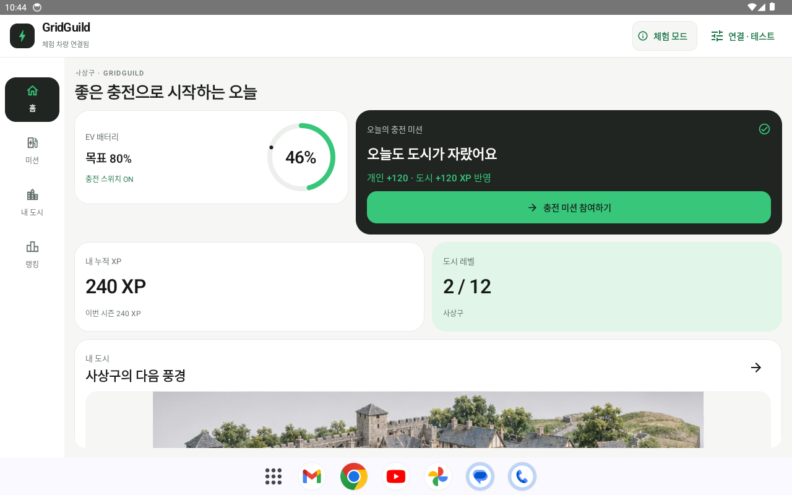
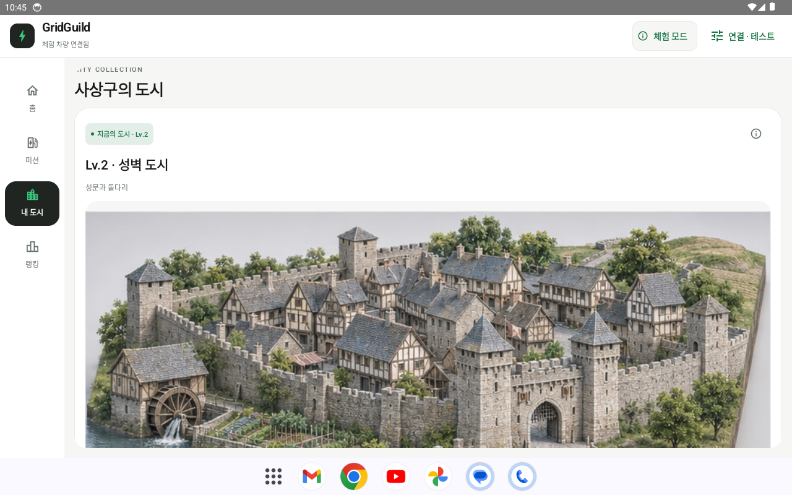

# GridGuild 1차 제출 검증 기록

작성일: 2026-11-14. 제출 기준 태그: **`submission-2026-11-15`**.

## 제출 정보

| 항목 | 값 |
|---|---|
| 저장소 | https://github.com/youkjp2301-star/GridGuild (Public) |
| APK 경로 | `apk/GridGuild_GridGuild_release.apk` |
| 버전 | 0.14.1 / code16 / `com.gridguild` |
| 실제 파일 크기 | 86,642,803 bytes (약82.6MiB) |
| SHA256 | `f03e6b829d400af2473d0c0ed02d32cdc50eb9a4ec00238e6f9ee053031326c6` |
| 공개 서명 인증서 SHA256 | `f6ba5fa92acc980a5d8ee95eb892f706de5f0c4662e850060f698f6ecea65ebd` |

최종40자리 Commit Hash는 `git rev-parse 'submission-2026-11-15^{commit}'`로 확인한다. 자기 자신의 해시를 같은 커밋 파일에 적을 수 없으므로 고정 태그를 기준으로 삼는다. 업로드 후 로컬 `artifacts/submission-2026/SUBMISSION_RECEIPT.txt`에도 주소·전체 커밋·APK 경로를 별도 기록한다. 이 영수증과 원시 로그는 Git에서 제외한다.

## 실제 Release 빌드·정적 검사

- `scripts/build-release.ps1`: 실제 `:app:assembleRelease` 및 `:app:lintRelease` 성공. Debug 파일 이름 변경 방식이 아니다.
- PKCS12 RSA4096 고정 Release 키로 서명. 개인 키·DPAPI 비밀번호 파일은 프로젝트 밖 사용자 프로필 `.gridguild/signing/`에 보관하고 Git에 포함하지 않는다.
- `apksigner verify --verbose --print-certs` 통과. `aapt2`로 패키지/버전과 `debuggable=false`, `testOnly=false` 확인.
- R8 및 리소스 축소로 APK를 GitHub 파일당100MiB 제한 이내로 줄였다. 원본 이미지/기획서/이전 소스는 삭제하지 않았다.
- `scripts/verify-release.ps1` 통과: 최적화 리소스 표에서 실제 PNG 경로를 추적하여 운전자 장면24장·도시3장·로딩1장 **28장 모두 유지**, 최대 RGBA6,294,152바이트 확인.
- Release Lint: **오류0 / 경고14**. 기존 Android Car/SDK deprecated 및 UI 관련 경고는 남아 있다.
- `:core:cleanTest :core:test`: **101개 통과 / 실패0 / 오류0 / 건너뜀0**,15개 suite. 미션/중복 지급 방지/신선도/안전·도시 레벨·시즌/랭킹·가용 충전기/주변 장소 경계 등을 검사했다.

## 설치·실제 화면 검증

### 환경과 데이터 보호

- 별도 신규 AVD **`GridGuild_Submission_QA_API34`**, Android14/API34 Google APIs x86_64,1280×800px/160dpi,RAM2048MB.
- Android Emulator37.2.13.0, Windows Hypervisor Platform 가속, SwiftShader 렌더러. 이 QA 실행에서는 Vulkan을 비활성화했다.
- 기존 `GridGuild_Mock_API34`, `GridGuild_Driver_QA_API34`, Pleos AVD 및 저장 데이터는 삭제·초기화·덮어쓰기하지 않았다. `-wipe-data`, `pm clear`, 기존 앱 제거를 사용하지 않았다.
- 앱 설치 전 QA의 System UI 정상 화면과 ANR 없음 확인. 제출 Release를 `adb -s emulator-5556 install apk/GridGuild_GridGuild_release.apk`로 설치해 **Success**, 실제 설치 앱의 DEBUGGABLE 플래그 없음 확인.
- 기존 공식 Pleos 검증 환경은 **Pleos Connect v2.1.0 / AAOS API34 /1920×1080px/160dpi/RAM4096MB**다. 이번 Release UI 검사는 위의 표준 Android **Mock** QA에서 했으며 실제 차량 서비스 시험과 혼합하지 않는다.

### 실제로 성공한 시나리오

실제 제출 APK를 일반 실행하고 외부 ADB/UIAutomator로 표시된 텍스트·버튼·화면을 검사했다. 게임 저장 파일 주입이나 테스트 fixture로 성과를 만들지 않았다.

| 단계 | 관찰한 결과 |
|---|---|
| 지역 선택 | 사상구 시작, 홈 SOC42%,0 XP,도시Lv.1 |
| ROUTE CHARGE | 삼락 강변 충전소 여유3/5기, 경유지 추가 완료, 일반 미션 시작 |
| 충전 관찰 | 테스트 콘솔의 충전 ON·SOC+2로44%,개인120 XP·도시120 XP,Lv.2 자동 반영 |
| HOME 등록·설정 | 우리 집 충전소 최초 등록, 목표80%,출발07:30 UI 저장 |
| HOME 참여·보상 | 일반 참여 후 충전 ON·SOC+2로46%,개인/도시 누적240 XP,Lv.2 유지 |
| 도시 | 이전 해금Lv.1 열람과 현재 도시로 돌아가기 동작,현재Lv.2·240 XP·다음까지10 XP 표시 |
| 지역 랭킹 | 내 소속 사상구 `Lv.2 · 누적 도시240 XP`,월간 점수240 XP; 누적 필터도240 XP |
| 개인 랭킹 | 내 점수240 XP 반영 |
| 프로세스 재실행 | 앱 종료·일반 재실행 후240 XP/Lv.2/목표80%/출발07:30/등록 충전소 유지,HOME 오늘 보상 완료 유지 |
| 주행 안전 | D 시뮬레이션에서 게임 탭이 사라지고 주차 안내 표시,P 복귀 후240 XP/Lv.2 유지 |

Mock 차량의 SOC/충전 스위치는 프로세스 재시작 시 초기42%/OFF로 돌아간다. 차량 현재값을 저장 게임 성과로 오인하지 않으며 XP·도시·집 설정·완료 기록은 그대로 보존됨을 확인했다.

실제 QA 캡처:

### 실패한 검사와 원인 분리

- minified Release의 Compose instrumentation 준비 중 AndroidX Test의 컴파일용 annotation 누락을 확인했다. 보완 후 테스트 APK 빌드는 성공했으나, 실행 시 `AndroidJUnitRunner.onCreate`에서 `NoClassDefFoundError: androidx.tracing.Trace`가 발생했다. 대상 앱 R8과 테스트 APK 사이 공유 라이브러리 제거 문제로 앱 화면 이전에 실패한 것이다.
- 이 instrumentation 실행은 **성공으로 집계하지 않는다**. 시험용 의존성/설정/실험 테스트 파일은 최종 소스에 남기지 않았고 기존 Debug 검사 구성은 유지했다.
- 일반 Release의 `MainActivity` 실행과 위 실제 기능 흐름은 별도로 성공했다. 외부 검사 도구 `scripts/submission-smoke.py`는 정확한 QA AVD 및 non-debuggable 앱을 확인하고 UI 조회/선택/스크롤/캡처만 제공한다. 원본 AVD 대상 실행과 캡처 덮어쓰기를 거부한다.
- 최초 외부 캡처의 검은 화면은 QA 화면이 꺼진 상태(`mAwake=false`)였다. 화면을 깨운 후 정상 UI가 표시됐다. 재부팅·AVD 재생성·앱 데이터 삭제로 처리하지 않았다.
- 이번 QA의 System UI/전화 앱 종료와 ANR은 관찰되지 않았다. 원시 crash log에 남은 위 instrumentation 도구 실패를 일반 앱 실행 성공과 구분한다.

## Pleos SDK 완료·미완료

- 공식 Vehicle2.3.2/NaviHelper3.0.5 타입·Maven·컴파일 유지. 과거 공식 Pleos 프로브에서 SOC/충전 스위치/기어P/CarUxRestrictions 응답을 받은 기록은 [SDK_VERIFICATION.md](SDK_VERIFICATION.md)에 있다.
- 이번 Release에서 실제 Pleos 차량 변화 종단 보상,실제 Navi 목적지/경유지/재탐색 성공을 새로 검증하지 않았다. 기존 실제 Navi 목적지 콜백 타임아웃/경유지 종단 미검증은 미완료다.
- 충전소 현황·추천 시간·전력망·주변 장소·경쟁자는 Mock,성과는 데모 XP다. 실제 충전 제어/장소 인증/온라인 랭킹/결제·쿠폰·환전은 미연동이다.
- 실제 P + CarUxRestrictions 안전 경계는 유지한다. N 체험이 실제 N/D단 게임 허용을 우회하지 않는다.

## 보안과 후속 개발

- 기존20개 커밋의 고유 blob371개 중 텍스트331개 및 민감 파일명을 검사해 비밀정보 패턴 발견0. 기존 이미지 출처·CC0/CC BY-SA4.0 크레딧과 해시는 유지한다.
- 최종 stage184파일에 `scripts/check-secrets.ps1`를 실행해 통과했다. APK는 사용자 승인된 정확한 제출 경로만 허용하며 키·비밀번호·SDK/로컬 설정·다른 빌드 산출물은 제외한다.
- 기존 전체 Git 이력을 유지하고1차 제출 태그를 이동/강제 변경하지 않는다. 이후 개발은 새 커밋으로 진행한다. 두 PC 모두 시작 전 pull,종료 시 DEV_LOG와 함께 commit/push한다.
- 공개 저장소는 최소2026-11-23까지 공개 상태를 유지한다(사용자 제공 공모전 규정). 신청서/메일 발송과 시연 영상 최종 제출은 사용자가 수행한다.
